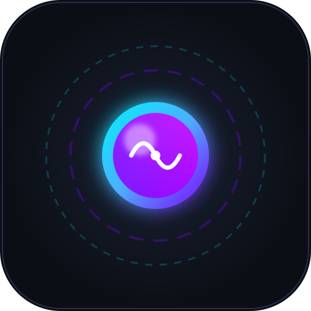

# AURA - Autonomous AI Personal Assistant Ecosystem (Web + PWA + Shared Cloud Backend)

<p align="center">
  
</p>

AURA is an autonomous, multilingual AI personal assistant ecosystem designed to deliver a modern application experience across **Responsive Web, Installable Progressive Web App (PWA), and Native Android**.

> **IMPORTANT DISTRIBUTION NOTICE**: In accordance with the project specifications, **no APK or AAB file is generated or distributed to users**. AURA is delivered directly through modern browsers as an installable PWA that users can open, add to their home screen, and operate as a standalone native-feeling application with offline capabilities and zero APK installation friction. The original Kotlin Android codebase is strictly preserved as an architectural benchmark.

---

## 🌟 Ecosystem Overview

1. **Responsive Web Application (`web/`)**: Built with React, Vite, Tailwind CSS, and Web Speech API. Features a dynamic 3D-styled glowing AI orb, reactive audio visualizers, and 14 complete dedicated views.
2. **Installable PWA (`web/dist/`)**: Manifest V3 compliant PWA with custom installation triggers, Service Worker offline caching, background synchronization, and Web Push notifications.
3. **Shared Backend (`backend/`)**: Node.js & Express REST API with PostgreSQL relational database migrations, persistent local fallback adapter, JWT authentication, user isolation, and multi-client synchronization.
4. **Android Benchmark (`app/`)**: The complete native Kotlin codebase using Jetpack Compose, Room SQLite database, and system controllers, enhanced with an `AuraApiClient` for cloud synchronization.

---

## 🌟 Key Highlights & Architectural Principles

- **Hands-Free Background Wake-Word Engine**: Listens for `"Hey AURA"` via a continuous Android Foreground Service (`foregroundServiceType="microphone"`) with ongoing notification status.
- **Strict Main Voice Interface**: The primary voice interface contains **strictly and exclusively** four voice-management controls:
  1. `ADD VOICE` - Enrolls voice profile and initializes continuous listening.
  2. `REMOVE VOICE` - Removes the active voice profile.
  3. `DELETE VOICE` - Permanently purges saved voice preferences after confirmation.
  4. `PAUSE VOICE` - Toggles listening state between paused and active.
  *(All device controls such as flashlight, wifi, bluetooth, volume, and music are operated strictly via natural voice commands).*
- **Multilingual Support**: First-class support for **English**, **Telugu (తెలుగు)**, and **Hindi (हिन्दी)** with native speech recognition, localized command understanding, and Text-To-Speech (TTS).
- **Persistent Local Database (Room)**: Fully persistent storage for notes, ordered points, tasks, reminders, alarms, command history, and preferences that survive reboots.
- **Save Points & Repeat Points**: Interactive multi-point voice note capture that preserves strict point ordering (`Point 1`, `Point 2`, `Point 3`...) and reads them back aloud upon request (`"Hey AURA, repeat my saved points"`).
- **Free-Time Reminders**: Natural scheduling within user-specified time intervals (e.g. *"Remind me during my free time between 6 PM and 8 PM"*).
- **Reboot Persistence**: `BootReceiver` automatically restores the listening foreground service and reschedules exact reminders/alarms via `AlarmManager` upon `BOOT_COMPLETED`.
- **Hardware Integrations**: `CameraManager` for flashlight toggle, `AudioManager` for volume, `Settings.System` for brightness, `ContactsContract` for contact lookups, `MediaSession` for music control, and `BatteryManager` for system metrics.
- **Supporting Backend**: A lightweight Node.js/Express REST API in `backend/` for cross-device cloud synchronization where needed.

---

## 📂 Project Structure

```text
AURA/
├── app/
│   ├── build.gradle.kts                 # Android Gradle configuration (SDK 34, Compose, Room, KSP)
│   ├── proguard-rules.pro               # ProGuard / R8 rules
│   └── src/main/
│       ├── AndroidManifest.xml          # Complete permissions & service declarations
│       ├── java/com/aura/assistant/
│       │   ├── AuraApplication.kt       # Application class & notification channels
│       │   ├── data/
│       │   │   ├── local/
│       │   │   │   ├── AuraDatabase.kt  # Room SQLite database (7 tables)
│       │   │   │   ├── entity/          # NoteEntity, NotePointEntity, ReminderEntity, AlarmEntity...
│       │   │   │   └── dao/             # NoteDao, ReminderDao, AlarmDao, TaskDao, PreferenceDao...
│       │   │   └── repository/
│       │   │       └── AuraRepository.kt# Repository coordinating Room DB & AlarmManager
│       │   ├── voice/
│       │   │   ├── AuraWakeWordEngine.kt# Continuous wake-word detection loop ("Hey AURA")
│       │   │   ├── AuraSpeechRecognizer.kt# Android SpeechRecognizer wrapper with RMS audio feed
│       │   │   ├── AuraTextToSpeech.kt  # Multilingual TTS engine (EN, TE, HI)
│       │   │   ├── LocalCommandEngine.kt# Rule-based intent, entity, and slot parser
│       │   │   ├── CommandModel.kt      # AuraAction, AuraCommand, and CommandResult
│       │   │   └── MultilingualDictionary.kt # Multilingual phrase dictionaries
│       │   ├── service/
│       │   │   ├── AuraForegroundService.kt # Foreground service managing background listening
│       │   │   ├── BootReceiver.kt      # BOOT_COMPLETED receiver for alarm rescheduling
│       │   │   └── ReminderAlarmReceiver.kt # Broadcast receiver firing exact reminders & alarms
│       │   ├── integration/
│       │   │   ├── AndroidActionManager.kt  # Coordinator executing validated commands
│       │   │   ├── AppLauncher.kt           # Launches YouTube, WhatsApp, Maps, Spotify, etc.
│       │   │   ├── FlashlightController.kt  # CameraManager torch control
│       │   │   ├── VolumeBrightnessController.kt # Audio and screen brightness controls
│       │   │   ├── CallContactManager.kt    # Contacts lookup and ACTION_CALL / ACTION_DIAL
│       │   │   ├── MediaMusicController.kt  # MediaSession key event dispatching
│       │   │   └── DeviceConnectivity.kt    # Battery, Date/Time, Bluetooth, and Wi-Fi checks
│       │   └── ui/
│       │       ├── MainActivity.kt          # Compose Activity & runtime permissions
│       │       ├── theme/                   # Futuristic Cyberpunk Dark Theme (Cyan/Violet)
│       │       ├── navigation/              # 5-Tab Navigation structure
│       │       ├── components/              # GlowingOrb, AuraButton, ConnectionCard, NoteCard
│       │       ├── screens/                 # HomeScreen, VoiceAssistantScreen, ConnectionsScreen...
│       │       └── viewmodel/               # AuraViewModel & ViewModelFactory
│       └── res/                             # Vector drawables, colors, strings, themes
├── backend/
│   ├── package.json                         # Node.js dependencies (Express, CORS)
│   ├── server.js                            # Express server entry point (Port 4000)
│   └── routes/
│       └── sync.js                          # Cloud sync REST endpoints for notes & reminders
├── build.gradle.kts                         # Root Gradle script
├── settings.gradle.kts                      # Module management
├── gradle.properties                        # JVM memory & AndroidX flags
└── gradlew.bat / gradlew                    # Gradle 8.5 Wrapper scripts
```

---

## 🗣️ Multilingual Voice Commands Reference

AURA accepts natural-language spoken commands across English, Telugu, and Hindi:

### 1. Application Launching
- **English**: *"Hey AURA, open YouTube"* | *"Open WhatsApp"* | *"Launch Spotify"* | *"Open Google Maps"* | *"Open Camera"*
- **Telugu**: *"హే ఆరా, యూట్యూబ్ ఓపెన్ చెయ్యి"* | *"వాట్సాప్ ఓపెన్ చెయ్యి"*
- **Hindi**: *"हे ऑरा, यूट्यूब खोलो"* | *"व्हाट्सएप खोलो"* | *"कैमरा चालू करो"*

### 2. Flashlight & Hardware Controls
- **English**: *"Turn on the flashlight"* | *"Turn off the flashlight"* | *"Torch on"*
- **Telugu**: *"ఫ్లాష్ లైట్ ఆన్ చెయ్యి"* | *"ఫ్లాష్ లైట్ ఆఫ్ చెయ్యి"*
- **Hindi**: *"टॉर्च चालू करो"* | *"टॉर्च बंद करो"*

### 3. Volume & Brightness
- **English**: *"Increase volume"* | *"Decrease volume"* | *"Mute music"* | *"Brightness up"* | *"Brightness down"*
- **Telugu**: *"వాల్యూమ్ పెంచు"* | *"వాల్యూమ్ తగ్గించు"* | *"మ్యూట్ చెయ్యి"*
- **Hindi**: *"वॉल्यूम बढ़ाओ"* | *"आवाज कम करो"* | *"म्यूट करो"*

### 4. Calls & Contacts
- **English**: *"Hey AURA, call Mom"* | *"Call Rahul"* | *"Redial last number"*
- **Telugu**: *"అమ్మకు కాల్ చెయ్యి"* | *"రాహుల్ కి ఫోన్ చెయ్యి"*
- **Hindi**: *"मम्मी को कॉल करो"* | *"राहुल को फोन लगाओ"* | *"पिछला नंबर फिर से मिलाओ"*

### 5. Media & Music
- **English**: *"Play music"* | *"Pause song"* | *"Next song"* | *"Previous track"* | *"Stop music"*
- **Telugu**: *"పాట ప్లే చెయ్యి"* | *"పాట ఆపు"* | *"తర్వాతి పాట"*
- **Hindi**: *"गाना बजाओ"* | *"गाना रोको"* | *"अगला गाना"*

### 6. Smart Voice Notes & Ordered Points (Mandatory)
- **Capture Points**: *"Hey AURA, note this: complete the assignment, call the project team, prepare the presentation, and submit the report."*
- **Repeat Points**: *"Hey AURA, repeat my points"* | *"Repeat these points"* | *"Read my saved points"* | *"What did I ask you to remember?"*
- **Telugu**: *"నోట్ రాసుకో: ప్రాజెక్ట్ రివ్యూ చెయ్యి, టీమ్ కి కాల్ చెయ్యి"* | *"నా పాయింట్లు చెప్పు"*
- **Hindi**: *"यह बात लिख लो: असाइनमेंट पूरा करो, टीम को फोन करो"* | *"मेरे पॉइंट दोहराओ"*

### 7. Reminders & Free-Time Reminders
- **Exact Reminders**: *"Remind me to call Mom at 6 PM"* | *"Remind me about my assignment tomorrow at 9 AM"*
- **Free-Time Reminders**: *"AURA, remind me about these points during my free time between 6 PM and 8 PM"*
- **Telugu**: *"సాయంత్రం 6 గంటలకు గుర్తు చెయ్యి"* | *"ఫ్రీ టైం లో 6 నుండి 8 గంటల మధ్య గుర్తు చేయి"*
- **Hindi**: *"शाम 6 बजे याद दिलाना"* | *"खाली समय में 6 से 8 के बीच याद दिलाओ"*

### 8. Alarms & Daily Briefing
- **Alarms**: *"Set an alarm for 6 AM"* | *"Wake me up at 5:30 AM"* | *"What alarms do I have?"* | *"Cancel my 6 AM alarm"*
- **Daily Briefing**: *"Hey AURA, what's my schedule today?"* (Reads today's reminders, active alarms, pending tasks, and latest points).

---

## 📱 Application Screens

### 1. Home Dashboard
Minimalist futuristic dashboard displaying:
- Real-time Assistant Online/Paused state.
- Glowing visualizer reflecting wake-word state.
- System metrics cards (Notes count, Reminders scheduled, Pending tasks).
- Recent voice command history stream with execution status.

### 2. Voice Assistant (Strict Main Voice Interface)
Implements Section 4 of the project specifications:
- Dynamic multi-layered **Glowing Voice Orb** with reactive audio level visualization.
- Real-time speech transcription card & spoken response bubble.
- **Strictly and exclusively** the 4 Voice Management Controls:
  1. `ADD VOICE`: Enrolls the user voice profile and starts background listening.
  2. `REMOVE VOICE`: Disenrolls voice profile.
  3. `DELETE VOICE`: Purges saved profile and preferences with confirmation dialog.
  4. `PAUSE VOICE / RESUME VOICE`: Toggles continuous listening.

### 3. Connections
Hardware and network integration status cards with live permission status:
- **VOICE CONNECTION**: Microphone, wake-word engine, and speech engine status.
- **PHONE CONNECTION**: Contacts access, dialer capability, and notification permissions.
- **MUSIC CONNECTION**: Active MediaSession state (Spotify / YouTube Music / System Player).
- **DEVICE CONNECTION**: Flashlight hardware status, Bluetooth adapter, and Wi-Fi state.
- **INTERNET CONNECTION**: Online/Offline status indicator.

### 4. Notes & Reminders
Tabbed management for all stored entities:
- **Notes & Points**: Displays notes with their exact ordered points (`1.`, `2.`, `3.`), timestamps, delete button, and a `"Read Points Aloud"` button.
- **Reminders**: Lists active and free-time window reminders.
- **Alarms**: Displays scheduled alarms with toggle switch.
- **Tasks**: Checkable task list with completion tracking.

### 5. Settings
- **Language Switcher**: English, Telugu (తెలుగు), and Hindi (हिन्दी).
- **Speech Rate & Pitch**: Adjusts Text-To-Speech speed and tone.
- **Wake Word Sensitivity**: Adjusts acoustic trigger threshold.
- **Battery Optimization Guidance**: One-tap shortcut to disable Android battery restrictions for continuous background wake-word operation.
- **Data & Reboot Security**: Information on local Room DB persistence.

---

## 🛠️ Step-by-Step Installation & Building

### Prerequisites
- **Android Studio Iguana / Jellyfish / Ladybug (or newer)**
- **Java JDK 17** (Temurin / OpenJDK 17)
- **Android SDK Platform 34** with Build Tools `34.0.0`
- Android device running **Android 8.0 (API 26) or higher** (Android 10+ recommended)

### Build Debug APK via Command Line
```powershell
# Set JAVA_HOME and ANDROID_HOME (adjust paths if custom)
$env:JAVA_HOME = "C:\Users\admin\jdk-17\jdk-17.0.21.1+2"
$env:ANDROID_HOME = "C:\Users\admin\Android\Sdk"
$env:PATH = "$env:JAVA_HOME\bin;$env:PATH"

# Navigate to project directory
cd "C:\Users\admin\.gemini\antigravity\scratch\AURA"

# Compile and assemble the Debug APK
.\gradlew.bat assembleDebug
```

The generated APK will be available at:
`app/build/outputs/apk/debug/app-debug.apk`

### Install onto Connected Android Phone
```powershell
adb install -r "app\build\outputs\apk\debug\app-debug.apk"
```

### Build Release APK
To assemble an optimized release APK:
```powershell
.\gradlew.bat assembleRelease
```
*(Configure signingConfigs in `app/build.gradle.kts` with your release keystore).*

---

## 🚀 Running the Supporting Node.js Backend

The backend is optional and only required when cross-device cloud synchronization is enabled.

```bash
cd backend
npm install
npm start
```
The server will start on port `4000`:
- Health Check: `GET http://localhost:4000/api/health`
- Sync Notes: `POST http://localhost:4000/api/sync/notes`
- Sync Reminders: `POST http://localhost:4000/api/sync/reminders`
- Pull Data: `GET http://localhost:4000/api/sync/pull`

---

## 🔋 Battery Optimization & Background Execution

Android's Doze mode and OEM battery management (e.g. Xiaomi MIUI/HyperOS, Samsung OneUI, OnePlus OxygenOS) can terminate background microphone listening after extended idle periods.

To ensure uninterrupted `"Hey AURA"` wake-word detection:
1. Open **Settings** inside AURA.
2. Tap **"Disable Battery Restrictions"** under Battery Optimization.
3. Select **"Unrestricted"** or **"Don't optimize"**.
4. Lock AURA in the Recent Apps tray if supported by your OEM.

---

## 🔒 Privacy & Security Guarantee

- **Zero Secret Recording**: AURA displays a permanent foreground notification whenever the microphone is active.
- **Local Command Parsing**: Spoken commands are parsed directly on your device. No user audio is sent to OpenAI, ChatGPT, or external chatbot servers.
- **Safe Deletion**: Tapping `DELETE VOICE` securely wipes all saved profile preferences and stops active listening immediately.
